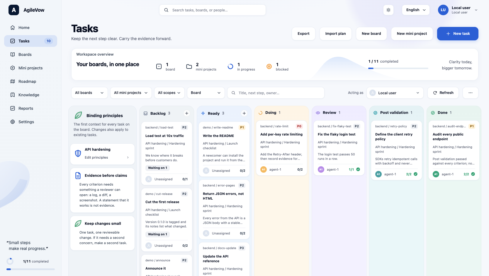

# AgileVow

A Kanban board for AI agents, and the people working with them, where a card is claimed with a lease, needs evidence for every acceptance criterion, and reaches Done only through a validation step.



## Why it exists

When the same agent does the work and reports on it, nothing stops it from declaring the work finished. AgileVow puts rules between those two steps:

- **Leases.** An agent claims a card and gets a secret token with an expiry. Only the holder of the token can edit, comment on or advance a card that is in Doing. A dead session is recovered explicitly, with a note, after its lease runs out.
- **Evidence.** Every acceptance criterion on a card needs an evidence entry (a reference and a note) before the card can leave execution.
- **A validation gate.** No status change reaches Done. A card gets there only through a `validate` action that records a pass or fail for every acceptance criterion and every board-wide principle. A fail sends the card back to Review with a repair checklist (expected, avoid, fix).
- **Binding principles.** A board can carry standing requirements. Each card exposes their full text and a hash of it. A claim must quote the current hash, which forces the caller to fetch the current text (it does not prove the text was read), and validation must check every principle.

It is one Python package with no dependencies, a SQLite file for storage, a JSON API, a web board and a small CLI. It does not start agents or schedule work: it records what happened and refuses transitions that skip the discipline.

## Try it

Python 3.9 or newer on macOS or Linux. Nothing to install, and no database to set up: it is a SQLite file the server creates on first run.

```sh
git clone https://github.com/YarivReznik/AgileVow.git
cd AgileVow
python3 -m agilevow demo
```

That creates `agilevow-demo/` (ignored by git), fills it with a sample board, eleven tasks from Backlog to Done, and opens <http://127.0.0.1:8765/>. Every card got where it is through the API, by the same rules an agent follows: claimed with a lease, evidence for each criterion, a validation report before Done. Delete the folder to start over. `--dir` and `--port` change where it lives, `--no-open` skips the browser, and a folder that already has boards is served as it is, never filled again.

## Quickstart

Your own board, from the command line. Stay in the clone; every command below runs from there. (`pip install .` also installs a `agilevow` command that replaces `python3 -m agilevow`.)

Terminal 1, serve a project folder (it must already exist; a mistyped path is refused, not created):

```sh
python3 -m agilevow serve --root /path/to/project
```

```text
AgileVow: http://127.0.0.1:8765/
Project: /path/to/project
Data:    /path/to/project/.agilevow
```

Open <http://127.0.0.1:8765/> for the board. Terminal 2, in the same clone:

```sh
export AGILEVOW_ACTOR=alice
cat > /tmp/principles.json <<'EOF'
[{"key": "terse", "title": "Terse", "content": "Say it in one line."}]
EOF
python3 -m agilevow client create-board demo "Demo board" --principles /tmp/principles.json
python3 -m agilevow client import examples/plan.json --board demo
python3 -m agilevow client tasks --board demo
```

```text
board-<id>  demo  (1 principle)
imported: plan-<id>  3 tasks
task-<id>  ready           write-readme             Write the README
task-<id>  backlog         cut-release              Cut the first release
task-<id>  backlog         announce                 Announce it
```

Ids are shortened here. Read the card before claiming it; the last line of `context` is the hash of the principles:

```sh
python3 -m agilevow client context write-readme
```

```text
# Binding principles
Read these board-wide user/project requirements before interpreting the task. ...

1. Terse
Say it in one line.

# Task
Write the README
...
principles_sha256: 1b39e6769136cebc81fa708a37e4fc4ac93334c23a6f2bd9c897d3352e41c1e0
```

Claim it with that hash, record evidence for both criteria (0-based index), and add a decision note:

```sh
python3 -m agilevow client claim write-readme --ack-principles 1b39e6769136cebc81fa708a37e4fc4ac93334c23a6f2bd9c897d3352e41c1e0
echo "Installed from a clean checkout; every command ran." > /path/to/project/notes.md
python3 -m agilevow client evidence write-readme 0 notes.md --note "Followed the steps on a clean checkout"
python3 -m agilevow client evidence write-readme 1 notes.md --note "Ran each command and compared the output"
python3 -m agilevow client comment write-readme "Kept the install steps to two commands" --kind decision
```

```text
claimed task-<id> for alice; lease kept in /path/to/clone/.agilevow/leases.json
task-<id>  doing           write-readme             Write the README
task-<id>  doing           write-readme             Write the README
task-<id>  doing           write-readme             Write the README
```

An evidence reference is free text; a path relative to `--root` that exists becomes a link on the board. Tick the criteria that have evidence (a tick is refused without it), then move the card through Review to Post validation:

```sh
python3 -m agilevow client check write-readme
python3 -m agilevow client move write-readme review
python3 -m agilevow client move write-readme post_validation
python3 -m agilevow client move write-readme done
```

```text
task-<id>  doing           write-readme             Write the README
task-<id>  review          write-readme             Write the README
task-<id>  post_validation write-readme             Write the README
agilevow: POST /api/tasks/action: HTTP 409 {"error": "transition from post_validation to done is not allowed"}
```

The last refusal is the point: there is no move to Done. Validate instead. `review prepare` writes a report with one pending row per criterion and per principle; fill every row from what you actually inspected, then submit it:

```sh
python3 -m agilevow review prepare --task TASK-ID --report /tmp/report.json
```

`TASK-ID` is the `task-...` id from `client tasks`; `prepare` refuses to overwrite an existing report file. For each row set `result` (`pass` or `fail`), `method`, `observations` and `evidence` (a list of references); a `fail` also needs `expected`, `avoid` and `fix`. Set `reviewer` and `summary` at the top. Then:

```sh
python3 -m agilevow review submit --task TASK-ID --report /tmp/report.json
```

```text
{"task": "task-<id>", "status": "done"}
```

With any `fail` row the status would be `review` instead, and the card would carry a correction checklist. [docs/WORKFLOW.md](docs/WORKFLOW.md) walks that loop, and [docs/AGENTS-SNIPPET.md](docs/AGENTS-SNIPPET.md) is a block to paste into an agent's instructions so it uses the board this way.

## What a card's life looks like

1. **Backlog or Ready.** A card starts in `backlog` or `ready`. It can only become `ready` when every card it depends on is Done.
2. **Claim.** `claim` moves a ready card to `doing` and returns a lease token (default 900 s on the server, 3600 s from the CLI; range 60 to 3600). A board with principles also requires their current hash.
3. **Work.** The holder renews the lease, records evidence per criterion, ticks the checklist (a tick requires evidence with a reference and a note), and adds comments, links and attachments.
4. **Review.** `doing` to `review` is a checkpoint that releases the lease.
5. **Post validation.** `post_validation` needs every criterion to have evidence and a tick.
6. **Validate.** A `validate` action checks each criterion and each principle. All pass: `done`. Any fail: back to `review` with corrections; claim the repair, verify each correction, return to `post_validation`.

Editing a card's outcome, acceptance criteria, dependencies or sources needs a note, clears its evidence and checklist, and sends a card that was in Doing, Review, Post validation or Done back to `backlog`. A changed source file blocks claims and completion until someone reconciles it, with a note.

## Commands

All commands: `python3 -m agilevow <command>`. Run `--help` on any of them.

| Command | What it does |
| --- | --- |
| `demo [--dir DIR] [--port N] [--no-open]` | A sample board in its own folder (default `./agilevow-demo`), filled through the API and served. |
| `serve` | Run the board and API on 127.0.0.1. |
| `client boards` | List boards. |
| `client create-board KEY TITLE [--description] [--scope] [--principles FILE]` | Create a board. Repeating the same content is a no-op. `FILE` is a JSON list of `{key, title, content}`. |
| `client import PLAN.json --board KEY` | Import a plan file (see `examples/plan.json`). Repeating it is a no-op; changed content is a 409. |
| `client tasks [--board KEY]` | List tasks: id, status, key, title. |
| `client context TASK` | Print the principles and the task context, then `principles_sha256`. Read this first. |
| `client claim TASK [--ack-principles HASH] [--seconds N]` | Claim a ready task (or a failed task that has unverified corrections). Keeps the lease token in a local file. |
| `client renew TASK [--seconds N]` | Extend your lease by `N` seconds, 60 to 3600 (default 3600). |
| `client release TASK --note TEXT` | Hand a task back. The note is required and becomes its next step. |
| `client check TASK [N ...]` | Tick criteria that have evidence: the ones listed (0-based), or all. Ticks already there are kept. |
| `client move TASK STATUS [--note TEXT]` | Transition a task you hold: `review`, `post_validation`, `blocked`, ... Blocking and cancelling need `--note`. |
| `client comment TASK TEXT [--kind note\|conversation\|decision]` | Append a comment. |
| `client evidence TASK N REF [--note TEXT]` | Record evidence for criterion `N`, merging with what is already there. |
| `manager --board BOARD [--wip-limit N] [--stale-seconds N]` | Read-only audit as JSON: what to work on next and what is wrong. `BOARD` is the board key or its id. |
| `review prepare --task TASK-ID --report FILE` | Write a pending validation report for a task in Post validation. |
| `review submit --task TASK-ID --report FILE` | Check the report, store it as a decision comment, and run `validate`. |
| `mcp [--url URL] [--actor NAME] [--leases FILE]` | Serve the worker loop to an agent as MCP tools over stdio. See [docs/MCP.md](docs/MCP.md). |

`TASK` is a task key or id. If the same key exists in two plans, add `--plan PLAN-KEY` before the subcommand (`client --plan PLAN-KEY claim ...`); `--url` and `--actor` go in the same place. Not in the CLI: correction checks (Python client or API), recover and reconcile (Python client or API), board and plan edits, uploads. See [docs/API.md](docs/API.md).

Environment for `client`, `manager` and `review`:

| Variable | Default | Meaning |
| --- | --- | --- |
| `AGILEVOW_URL` | `http://127.0.0.1:8765` | Where the server is. |
| `AGILEVOW_ACTOR` | `agent` | Who is acting. Free text, not authenticated. |
| `AGILEVOW_LEASES` | `./.agilevow/leases.json` | Where `client` keeps lease tokens (owner-only file, relative to the current folder). The server shows a token once, at claim. |

## Use it from an agent (MCP)

`agilevow mcp` serves the same worker loop as [Model Context Protocol](https://modelcontextprotocol.io) tools over stdio, so an agent can resume work, read the principles, claim, record evidence and validate without a shell. It talks to the running server, so every rule above still applies, and it offers no way to create a board or to reach Done except `submit_review`.

```sh
claude mcp add agilevow -e AGILEVOW_ACTOR=claude -- agilevow mcp
```

Setup for other clients, the fifteen tools and what is deliberately missing: [docs/MCP.md](docs/MCP.md).

## `serve` options

| Option | Default | Meaning |
| --- | --- | --- |
| `--root DIR` | current folder | The project. Task sources and evidence paths are relative to it. Must already exist. |
| `--data-dir DIR` | `.agilevow` | Database and attachments, relative to `--root`. Must stay inside it. |
| `--port N` | `8765` | `0` picks a free port and prints it. |
| `--quiet` | off | Do not log each request. Server errors are still logged. |
| `--link-kinds a,b` | none | Extra link kinds (`pr,issue,commit`). `file`, `url` and `task` always exist. |

## Language and theme

The board is in English. Add `?lang=he` to the address for Hebrew (right-to-left), or use the language picker in the top bar, which remembers the choice in the browser. Without either, the browser's language decides: Hebrew if it starts with `he`, English otherwise.

The page follows the system's light or dark setting. The sun/moon button in the top bar switches it and remembers the choice in the browser.

## Honest limits

- A single-user local tool. There are no accounts and no authentication; `actor` is text the caller asserts. A lease coordinates cooperating agents, it does not identify them. Read [SECURITY.md](SECURITY.md).
- It binds `127.0.0.1` and accepts only `localhost:PORT` or `127.0.0.1:PORT` as Host and Origin. Reverse proxies, Docker port forwards, Codespaces and `[::1]` do not work, by design.
- POSIX only (macOS, Linux). Source and attachment paths are walked with `O_NOFOLLOW`, which Windows lacks.
- Python 3.9 or newer, standard library only. Not published on PyPI; install from a clone.
- Done requires validation by design. There is no override. A Done card can be reopened to `backlog` with a note.
- The sidebar lists Roadmap, Knowledge, Reports and Settings, as in the design the page follows. They are not features of this tool; clicking one says so. Home, Tasks, Boards and Mini projects work.
- The database is a plain SQLite file, `<root>/.agilevow/agilevow.sqlite3`. Export (`GET /api/tasks/export`) is an audit archive, not a restore format, and the latest 500 events per card, plan and board are kept. Copy the database and `.agilevow/assets/` while the server is stopped to back up.
- Nothing starts an agent or schedules a run. The manager reports; it does not act. The work-in-progress limit is advisory: the server lets one actor claim several cards, and the manager flags it.

## Project layout

```text
agilevow/             the package
  board.py           storage and every rule: statuses, transitions, leases, validation
  api.py             routes and the functions behind them
  server.py          HTTP server, security headers, the `serve` command
  client.py          the `client` command and the Python `Board` class
  manager.py         the read-only audit
  review.py          the post-validation report tool
  mcp.py             the MCP server (stdio)
  demo.py            the `demo` command: a sample board filled through the API
  web/               the board page: HTML, CSS, JavaScript, translations (i18n.mjs) and the icon set (icons.mjs)
tests/             unit tests and one browser test (tests/ui.cjs)
examples/plan.json a three-task plan to try
docs/              API.md, WORKFLOW.md, MCP.md, AGENTS-SNIPPET.md
SECURITY.md        threat model
package.json       development only: Playwright for the browser test
.github/           the CI workflow
```

## Tests

```sh
python3 -m unittest discover -s tests
```

The browser test needs Node and Playwright, a development dependency only (AgileVow itself has none). It starts its own server on a temporary project and downloads Playwright's Chromium on first use:

```sh
npm install && npx playwright install chromium && node tests/ui.cjs
```

Set `AGILEVOW_BROWSER_CHANNEL=chrome` to use the system Chrome instead.

## License

MIT. See [LICENSE](LICENSE).
